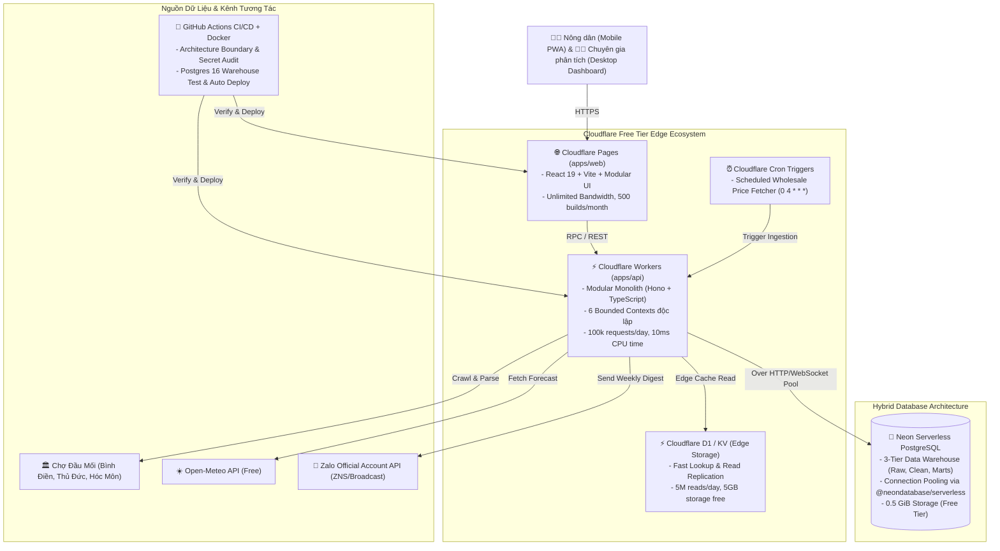

# Architecture, Modular Monolith Boundaries & Cloudflare Free Tier Strategy

## 1. Kiến trúc Hệ thống Tổng thể (Cloudflare Edge Topology)

## 2. Cấu Trúc Modular Monolith & Ranh Giới Module Độc Lập (Bounded Contexts)

Dự án tuân thủ nghiêm ngặt kiến trúc **Modular Monolith** để đảm bảo từng nghiệp vụ có boundary độc lập, không phụ thuộc chéo, sẵn sàng tách thành Worker/Microservice độc lập khi mở rộng quy mô:

- **`packages/contracts`**: Hợp đồng dữ liệu dùng chung (Zod Schemas, DTOs, Crop/Unit/Metric Dictionaries, Legal Disclaimers). Không phụ thuộc ngược vào `apps/*`.
- **`apps/api/src/core`**: Hạ tầng dùng chung tối giản (`config/env.ts` đọc secret từ root `.env` hoặc Worker bindings, `crypto/hash.ts` băm SHA-256 & PII nông hộ theo Nghị định 13/2023/NĐ-CP, `database/schema.sql`).
- **`apps/api/src/modules/*`** (6 Bounded Contexts độc lập, mỗi module có `domain/`, `application/`, `api/`, `__tests__/` và `index.ts` Public Facade riêng):
  1. **`ingestion` (Gate G0–G1)**: Cào dữ liệu chợ đầu mối, thời tiết Open-Meteo, tiếp nhận nhật ký vụ mùa.
  2. **`data-quality` (Gate G2)**: Phát hiện ngoại lệ MAD (Modified Z-Score), nội suy chuỗi thời gian, kiểm định chất lượng hằng ngày và tổng hợp Marts tuần.
  3. **`market-intelligence` (Gate G3–G4)**: Mô hình hồi quy phân vị (Q10/Q50/Q90), kiểm định ngược (Backtesting), mô phỏng Monte Carlo và tối ưu danh mục chia lô.
  4. **`farmer-advisory` (Gate G5)**: Rule Engine khuyến nghị 3 nhãn, thuật toán chống hiệu ứng đám đông (Anti-Herd), cá nhân hóa nông hộ và bản tin Zalo OA.
  5. **`field-experiment` (Gate G6)**: Hầm lưu trữ dự báo niêm phong bất biến (Forecast Vault) và phân tích tác động đối chứng A/B (Pilot vs Control).
  6. **`platform-ops` (Gate G7)**: Phát hiện trôi dạt dữ liệu (PSI Data Drift), quản lý hợp đồng B2B và kiểm toán chi phí hạ tầng 0đ.
- **Luật Ranh Giới (Enforced bởi `scripts/verify-architecture.mjs`)**:
  - Tuyệt đối cấm một module import trực tiếp vào thư mục nội bộ (`domain`, `application`, `api`) của module khác.
  - Mọi giao tiếp liên module bắt buộc đi qua `@agridata/contracts` hoặc Public Facade `index.ts`.

## 3. Chính Sách Quản Lý Secret & Docker / CI-CD Production
1. **Duy nhất 1 file `.env` ở Root**:
   - Toàn bộ biến môi trường và secret của dự án nằm duy nhất tại `/.env` ở thư mục gốc (được chặn hoàn toàn bởi `.gitignore` và `.dockerignore`) kèm file mẫu `/.env.example`.
   - Tuyệt đối không tạo `.env` hay `.dev.vars` rải rác trong các thư mục con (`apps/*`, `packages/*`).
   - Không bao giờ hardcode secret trong mã nguồn hoặc đóng gói cứng vào Docker image layer.
2. **Đóng gói Docker Multi-Stage & Docker Compose**:
   - `Dockerfile` gồm 6 stages (`base` -> `deps` -> `test` -> `builder` -> `api-runner` -> `web-runner`).
   - `docker-compose.yml` dựng sẵn cụm kiểm thử & staging đầy đủ: `postgres-warehouse` (PostgreSQL 16 tự động nạp `schema.sql` 3 tầng), `api` (Edge Worker runtime), `web` (Nginx SPA + Security Headers) và `test-runner`.
3. **Pipeline CI/CD (`.github/workflows/ci.yml`)**:
   - Tự động kiểm tra: (1) Quét rò rỉ secret & kiểm tra ranh giới Modular Monolith, (2) Kiểm thử schema PostgreSQL 16 + TypeScript check + 56 bài test tự động, (3) Kiểm thử đóng gói Docker multi-stage, (4) Tự động triển khai lên Cloudflare Workers & Pages.
